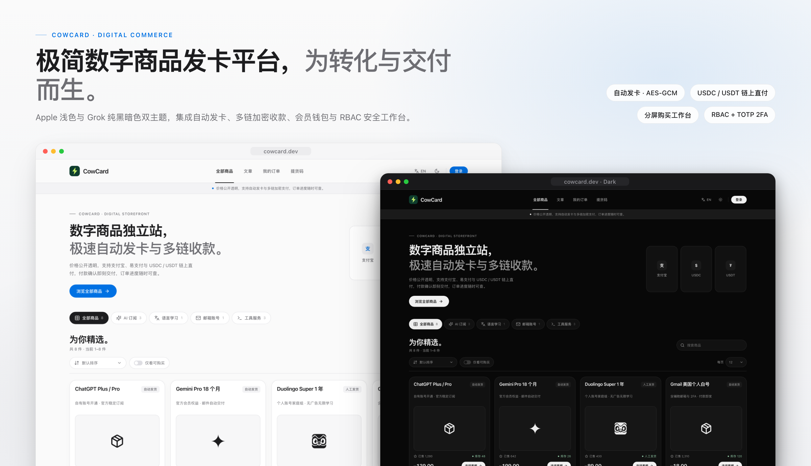
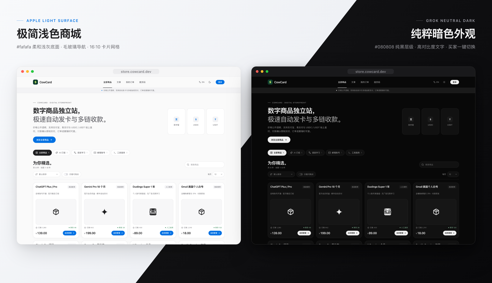
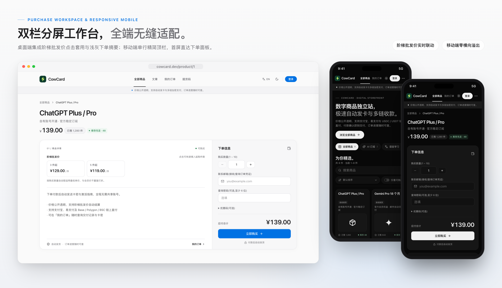
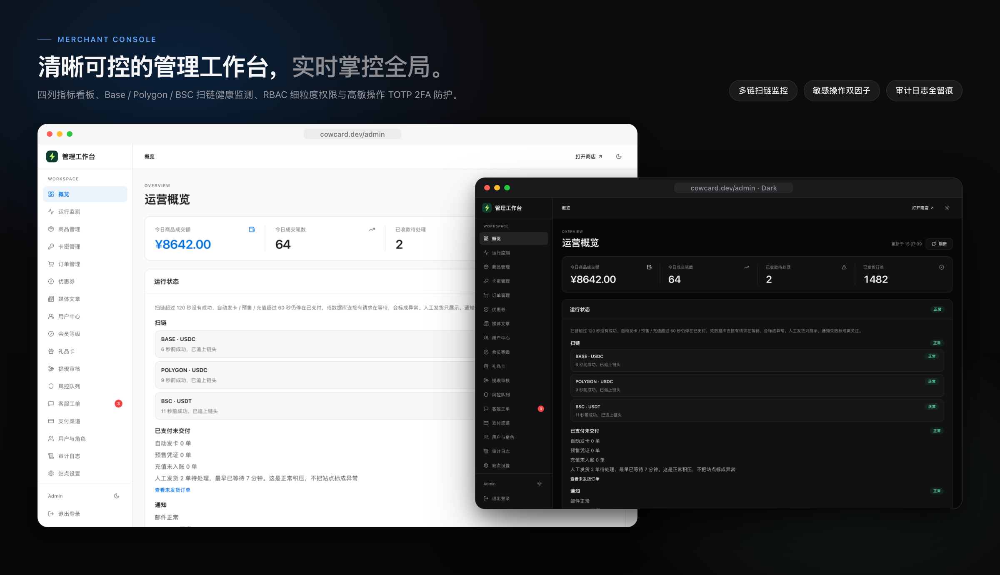

# cowcard

数字商品发卡平台，面向卡密售卖、账号密钥交付、预售提货、人工发货和会员制独立站运营场景。



cowcard 采用前后端分离架构：后端提供纯 REST API，前台承载买家下单、查单、会员中心、钱包和工单，后台承载商品、卡密、订单、支付、钱包、风控、客服、文章和系统配置。项目目标是让个人或小团队可以快速搭建一套可二次开发、可审计、可运营的数字商品销售系统。

## 界面预览

### 极简商城 · 浅色 / 暗色双主题



### 双栏分屏购买工作台 × 移动端首屏下单



### 现代化管理工作台



## 主要特性

| 模块 | 能力 |
|---|---|
| 商品销售 | 分类、商品、库存、自动发卡、人工发货、预售商品、会员专享价 |
| 卡密管理 | AES-GCM 加密存储、2FA 解锁查看、TXT/CSV 批量导入、未售卡密编辑/停用/删除、已售卡密追踪 |
| 订单支付 | 游客下单、会员下单、订单查询、支付成功交付、人工补单、关闭订单、退款到钱包 |
| 支付渠道 | 余额支付、Stripe、易支付协议、支付宝预留、加密货币转账与钱包直付 |
| 钱包系统 | 余额充值、余额消费、提现申请、冻结余额、礼品卡兑换、完整余额流水 |
| 会员体系 | 会员注册登录、邀请码、会员等级、等级折扣、商品级会员价、自动升级 |
| 优惠券 | 固定金额券、百分比券、门槛、限量、批量生成，批量创建需要 2FA |
| 预售提货 | 一次性提货码、不可逆哈希存储、提前核销、履约状态追踪、到期处理策略 |
| 客服工单 | 前台提交工单、客服回复、用户跟进、后台待处理提醒 |
| 风控审核 | 异常事项队列、封禁账号、冻结余额、处理记录和后台审计 |
| 内容运营 | 媒体文章、SEO 配置、TOS 页面、邮件模板、Telegram 成交通知 |
| 后台权限 | RBAC 角色权限、细粒度权限码、敏感操作密码 + TOTP 2FA |

## 技术栈

### 后端

- Java 17
- Spring Boot 4.x
- Spring Security + JWT
- Spring Data JPA / Hibernate
- MySQL 8
- Caffeine Cache
- TOTP 2FA
- AES-256-GCM 加密
- 策略模式支付网关

### 前端

- React 18
- Vite
- TypeScript
- Tailwind CSS
- Lucide React
- Axios

## 项目结构

```text
.
├── src/                      # Spring Boot 后端
│   ├── main/java/com/hqyj/ka
│   │   ├── article           # 媒体文章
│   │   ├── audit             # 审计日志
│   │   ├── card              # 卡密管理
│   │   ├── catalog           # 商品与分类
│   │   ├── coupon            # 优惠券
│   │   ├── dashboard         # 后台统计
│   │   ├── member            # 会员、登录、等级
│   │   ├── order             # 订单、交付、预售凭证
│   │   ├── payment           # 支付渠道与支付流水
│   │   ├── risk              # 风控队列
│   │   ├── security          # JWT、限流、认证过滤器
│   │   ├── support           # 客服工单
│   │   ├── sysconfig         # 系统配置与 SEO
│   │   ├── user              # 后台用户、角色、权限
│   │   └── wallet            # 钱包、提现、礼品卡
│   └── main/resources
│       └── db/migration/     # Flyway 版本化迁移
├── frontend/                 # React 前台 + 后台
├── docs/                     # 架构、安全、部署文档
├── .env.example              # 生产环境变量示例
└── run.sh                    # 后端启动脚本
```

## 快速启动

### 1. 准备数据库

```bash
mysql -u root -p < db-init.sql  # 仅开发建库/账号;表由 Flyway 创建
```

开发环境可参考 `db-init.sql` 创建本地数据库和用户。

### 2. 配置环境变量

```bash
cp .env.example .env
```

至少需要配置：

```env
KA_DB_USER=ka
KA_DB_PASSWORD=
KA_JWT_SECRET=
KA_AES_KEY=
KA_MERCHANT_ADDRESS=
KA_ADMIN_INIT_PASSWORD=
```

生成密钥示例：

```bash
openssl rand -base64 48   # KA_JWT_SECRET
openssl rand -base64 32   # KA_AES_KEY
```

`KA_AES_KEY` 用于加密卡密和支付渠道配置。生产环境必须单独备份，丢失后已加密数据无法恢复。

### 3. 启动后端

```bash
./mvnw -DskipTests package
./run.sh
```

首次启动会初始化权限、内置角色、支付渠道占位和初始管理员。

### 4. 启动前端

```bash
cd frontend
npm ci
npm run dev
```

生产构建：

```bash
npm run build
```

## 后台角色

| 角色 | 用途 |
|---|---|
| `SUPER_ADMIN` | 超级管理员，拥有全部权限 |
| `ADMIN` | 综合管理员，适合日常运营 |
| `OPS` | 运营，负责商品、卡密、订单、优惠券和文章 |
| `ORDER_MANAGER` | 订单专员，负责订单处理和交付跟进 |
| `FINANCE` | 财务，负责支付渠道、提现审核、礼品卡和对账 |
| `RISK` | 风控，负责异常订单、封禁和余额冻结 |
| `SUPPORT` | 客服，负责查单和工单处理 |
| `CONTENT` | 内容运营，负责媒体文章和展示内容 |
| `SECURITY_ADMIN` | 安全管理员，负责后台账号、角色权限和审计 |

## 安全设计

- 管理端使用角色 + 细粒度权限码控制菜单和接口。
- 高敏操作需要管理员密码 + TOTP 2FA。
- 卡密内容、支付渠道密钥等敏感配置使用 AES-256-GCM 加密落库。
- 卡密管理入口需要 2FA 解锁，已售卡密不允许编辑或删除。
- 余额冻结、提现审核、支付配置、礼品卡生成、订单补单等操作写入审计日志。
- 支付入账依赖金额校验、回调验签、唯一流水约束和订单状态 CAS，避免重复入账或未付款交付。
- 用户封禁会使会员登录态失效，并在关键操作前检查账号状态。
- 应用层提供限流和自动封禁；容量型 DDoS 仍需要 CDN、高防或 WAF。

更多细节见 [SECURITY.md](SECURITY.md) 和 [docs/SECURITY.md](docs/SECURITY.md)。

## 部署建议

- 使用 HTTPS，并通过 Nginx 反向代理 `/api/**` 到后端。
- 使用 MySQL 8，开启定期备份。
- `.env`、数据库备份、生产日志和真实密钥不要提交到 Git。
- 后台管理员首次登录后立刻修改初始密码并绑定 TOTP。
- 支付渠道密钥只在后台配置，不写入代码仓库。
- 若接入 Cloudflare 或其他 CDN，确认后端真实 IP 不直接暴露。

完整部署说明见：

- [docs/DEPLOY.md](docs/DEPLOY.md)
- [docs/ARCHITECTURE.md](docs/ARCHITECTURE.md)
- [docs/SECURITY.md](docs/SECURITY.md)

## 适用场景

- 数字卡密、兑换码、账号、密钥类商品销售。
- 虚拟服务、人工审核或人工交付型商品。
- 需要游客下单和会员钱包并存的独立站。
- 需要后台 RBAC、审计日志、风控审核和客服工单的运营型项目。
- 需要二次开发前台模板或定制支付交付流程的团队。

## 上线前检查

- [ ] 支付回调、同步跳转、订单查询、支付成功交付完整测试。
- [ ] 钱包充值、余额支付、提现审核、驳回退款完整测试。
- [ ] 卡密导入、自动发货、人工发货、预售核销完整测试。
- [ ] 后台角色权限和敏感操作 2FA 完整测试。
- [ ] 邮件模板、Telegram 通知和站点 SEO 设置已配置。
- [ ] 生产环境 `KA_AES_KEY`、`KA_JWT_SECRET`、数据库密码已妥善备份。
- [ ] Nginx、限流、防火墙、数据库备份和日志轮转已配置。

## 注意事项

本项目包含支付、钱包、卡密、提现和后台权限模块。上线前必须按真实业务流程做端到端测试，尤其是支付入账、订单交付、退款、提现和余额冻结。

请勿提交真实卡密、真实支付密钥、数据库备份、生产 `.env` 或生产环境日志。

## License

当前仓库尚未指定开源协议。公开使用、二次分发或商业化前，请先补充明确的许可证文件。

数据库升级及存量库接入见 [数据库迁移手册](docs/DATABASE_MIGRATIONS.md)。

上线前执行 `./mvnw -Pmysql-it verify`，运行 Testcontainers + MySQL 8 集成测试；环境要求和覆盖范围见 [测试手册](docs/TESTING.md)。
